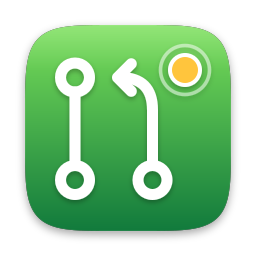
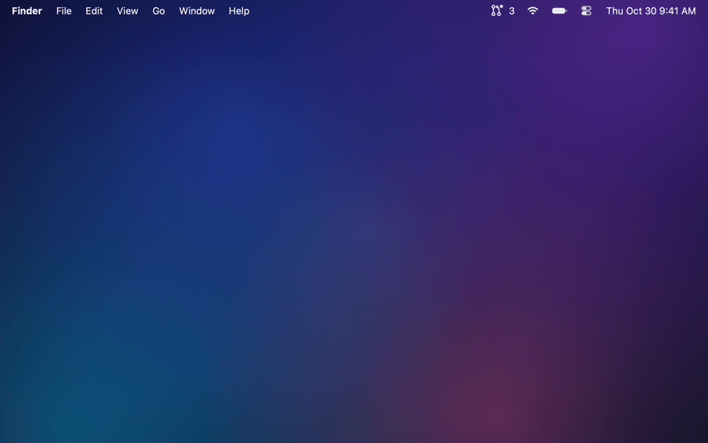
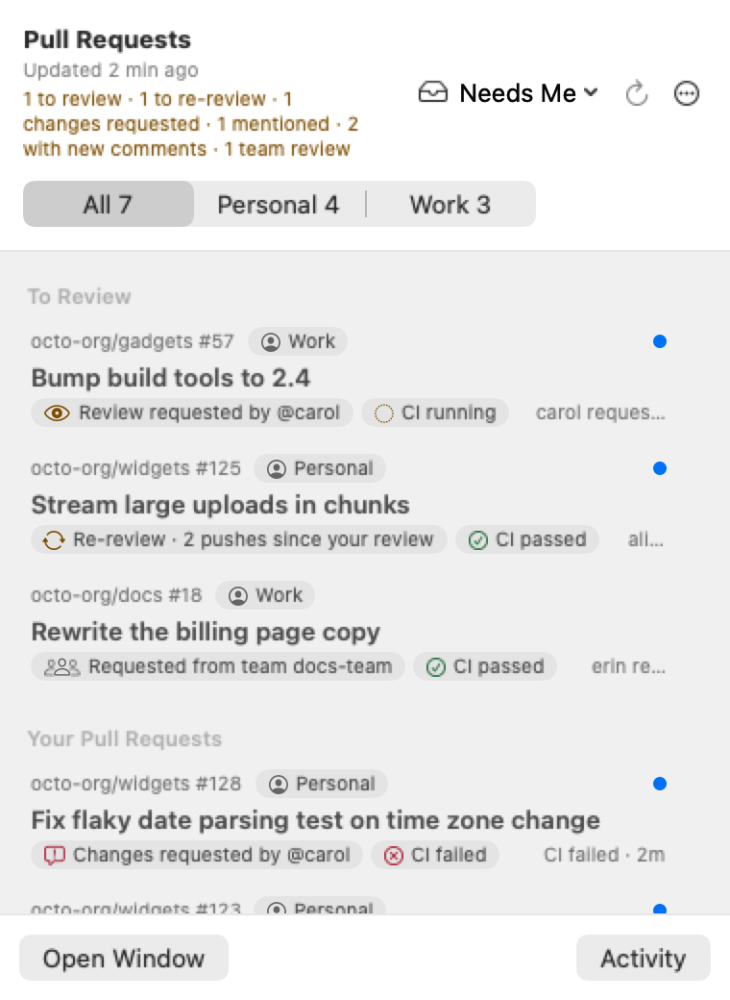
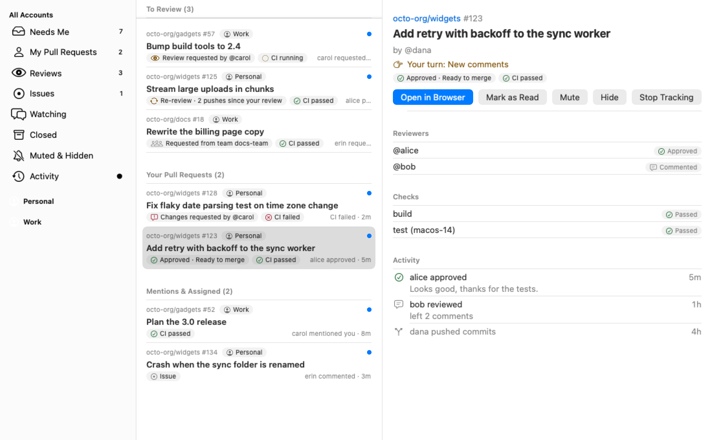
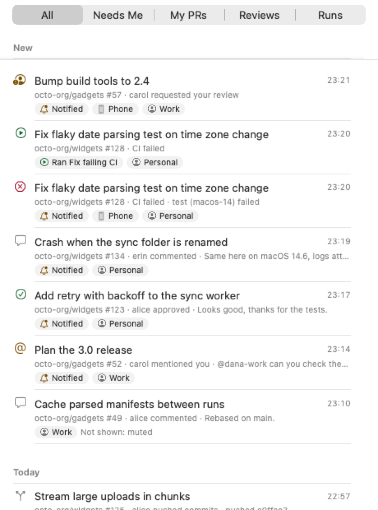
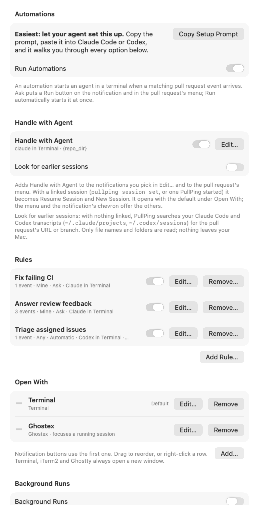
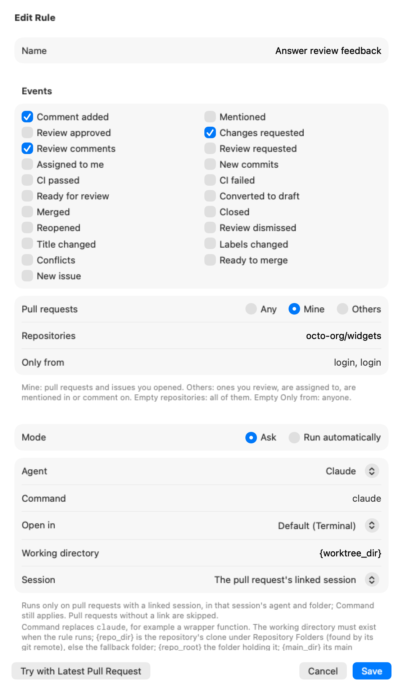
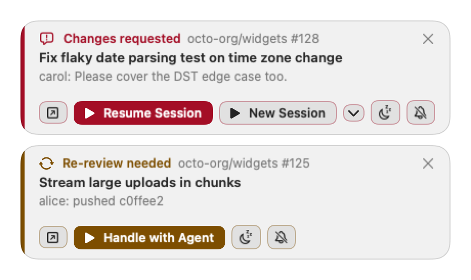
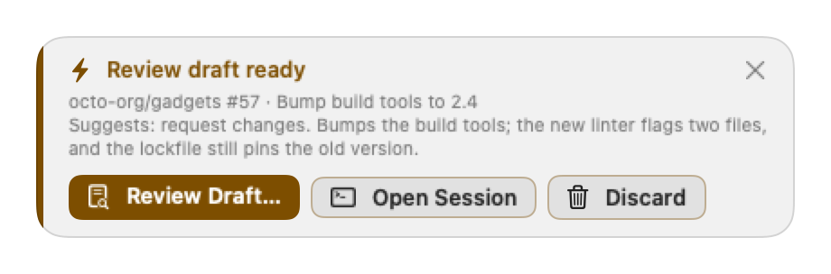
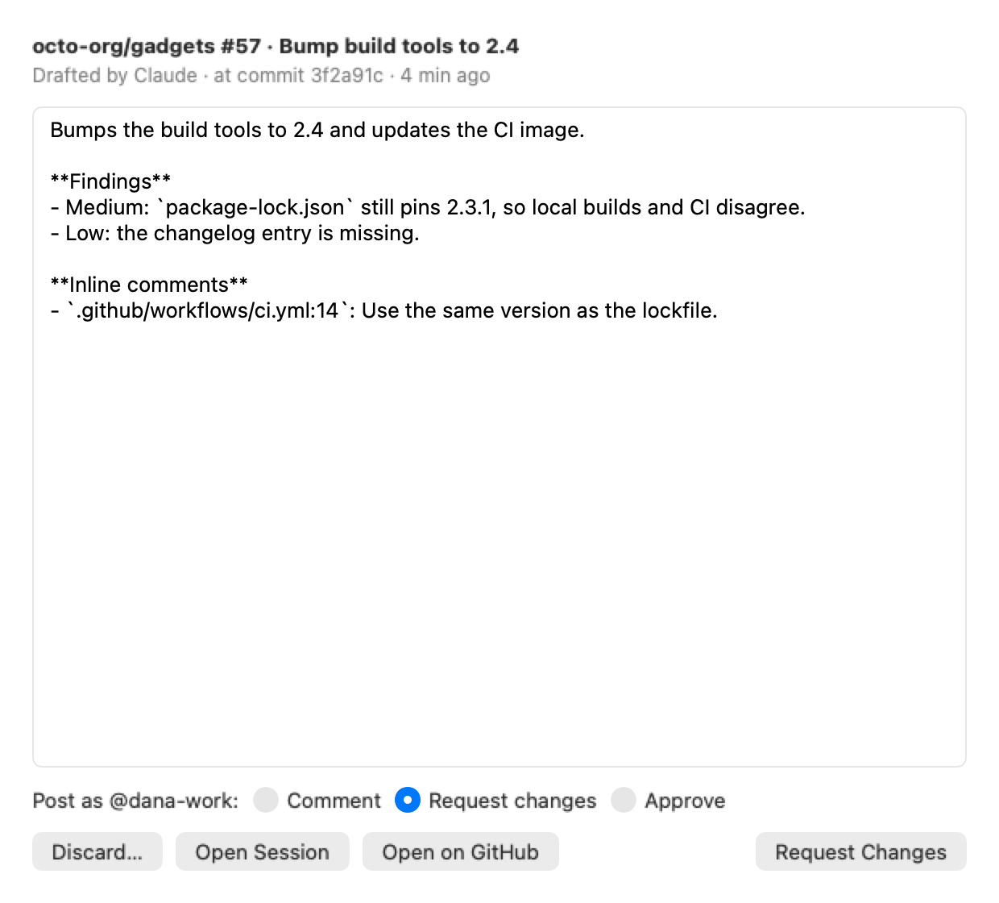

<div align="center">



# PullPing

### Know when your pull requests need you.

A small **macOS** menu-bar app that tracks every GitHub pull request (and issue) you are involved in,
across several accounts, and tells you when something happens: a review, a comment, a failing
check, a request for your review.

[](https://www.apple.com/macos/)
[](https://swift.org)
[](#requirements)
[](https://github.com/roypadina/PullPing/releases/latest)
[](https://github.com/roypadina/homebrew-tap)
[](https://github.com/roypadina/PullPing/actions/workflows/ci.yml)
[](https://apps.roypadina.synology.me/apps/pullping/)
[](LICENSE)
[](https://ko-fi.com/roypadina)
[](CONTRIBUTING.md)



<br>

```bash
brew install --cask roypadina/tap/pullping
```

<picture>
<source media="(prefers-color-scheme: dark)" srcset="docs/screenshots/status-panel-dark.png">

</picture>
&nbsp;


</div>

---

## Features

- **Every pull request you are involved in, in one place.** Ones you opened, ones assigned to you, ones where your review is requested (directly or through a team), and ones where you commented, reviewed or were mentioned. Merged and closed ones stay listed for a few days.
- **Issues too.** Open issues you opened, are assigned to, are mentioned in or commented on appear in the same lists with an **Issue** chip. Comments, mentions, assignments, label changes, renames, reopening and closing (shown as completed or not planned) are tracked like pull request events: mentions, assignments and comments on your issues notify, the rest is listed in Activity. Settings → General → Track Issues turns issues off.
- **Several GitHub accounts at once.** Personal and work, each with its own token and a label you choose.
- **Sorted by whose turn it is.** **Needs Me** lists what waits on you, oldest first: reviews and re-reviews asked of you, your pull requests to fix (changes requested, CI failed, conflicts) or to merge, mentions, assignments and new comments. **My Pull Requests** splits into Your Turn, Waiting on Others (reviewers, CI, auto-merge) and Drafts; **Reviews** into Needs Your Review, Team Requests and Reviewed; then **Issues**, **Watching**, **Closed** and **Muted & Hidden**. Each row has one status chip that says why it is there ("Re-review · 2 pushes since your review", "Changes requested by @carol", "Approved · Ready to merge", "Waiting on @alice, @bob"), plus CI, an unread dot and the latest activity.
- **Re-reviews you would miss.** A pull request you reviewed comes back to Needs Me when you are asked again, or when you requested changes and the author pushed since, even if they forgot to ask.
- **Menu-bar panel.** Needs Me by default, with what waits on others and what you reviewed one click away; the filter picks any other row. Switch between All accounts and each account. Right-click the icon for Refresh, Mark All as Read, Pause Notifications, Settings and Quit.
- **A count that means something.** By default the menu-bar number is the Needs Me list: review and re-review requests, unread assignments and mentions, your own pull requests with changes requested, failed CI, conflicts, new comments, or ready to merge, and new comments on issues you opened or are assigned to. The panel header spells it out ("2 to review · 1 ready to merge"). Settings → General → Count in the Menu Bar picks which of these count (team review requests have their own switch), or count everything unread, or show no number.
- **Main window.** Mail-style sidebar: the same rows for All Accounts and for each account, with counts of what is your turn, search across every row, and a detail view with whose turn it is, reviewers (and the commit each reviewed), checks and the recent activity of the selected pull request. Prefer one inbox per account? Settings → General → Inbox → Per account.
- **Phone notifications** through [ntfy](https://ntfy.sh), chosen per kind of event, separately from the desktop panels.
- **Agent automations.** Start Claude Code or Codex in a terminal when a pull request event arrives: rules you write in Settings, or hooks an agent attaches from the command line ("resume this session when the pull request is approved"). Asks first by default.
- **Background reviews, posted only by you.** Optionally, your agent reviews or summarizes a pull request without a terminal, with read-only tools, and hands you a draft: you edit it and click Post (comment, request changes or approve). Nothing reaches GitHub without that click.
- **Notifications only when something needs you.** A small panel appears at the top right when a review is asked of you, your pull request needs a fix or is ready to merge, or you are mentioned or assigned. It never takes keyboard focus and is grouped per pull request. Merges, passing CI, new commits and the rest go to Activity without a notification. Pick Off, Banner (hides itself) or Alert (stays) for each reason.
- **Activity.** Everything PullPing saw and did, in one list: every event, whether it notified you or went to your phone, plus every automation run. Filter it, and see what is new since your last look.
- **Review reminders.** While a review or re-review waits on you, PullPing nudges you again every so often until you review, the request is removed, or the pull request is merged or closed.
- **Snooze, mute, hide, mark as read, stop tracking.** All of them from the panel, the menu bar and the main window, with Undo for Hide and Stop Tracking. Hidden pull requests leave every list and count but still notify you.
- **Keyboard friendly.** Arrow keys and Return in the panel, menu commands with shortcuts, VoiceOver announcements for new notifications.
- **`pullping://` links** for Shortcuts and Raycast.
- Universal binary, no third-party dependencies, no analytics.

## Requirements

macOS 14 Sonoma or later · Apple Silicon and Intel (universal binary)

## Install

### Homebrew

```bash
brew install --cask roypadina/tap/pullping
```

### First launch

PullPing is signed with a self-made certificate, not notarized. If macOS blocks it, open
**System Settings → Privacy & Security**, scroll down and click **Open Anyway** next to
PullPing. Or clear quarantine once:

```bash
xattr -dr com.apple.quarantine /Applications/PullPing.app
```

A **Welcome** window then explains where PullPing lives and offers to open it at login (you can change it later in
Settings → General); PullPing never adds itself silently. **Settings → General → About → Welcome Guide…** opens it again.

### Updating

PullPing checks for a new version once a day and asks before installing it (**Check for Updates…** in the About
window checks now). An in-app update needs no `xattr` step. Homebrew users can also run `brew upgrade --cask pullping`.

### Build from source

```bash
git clone https://github.com/roypadina/PullPing.git
cd PullPing
./build.sh
open dist/PullPing.app
```

`build.sh` runs `swift build` for Apple Silicon and Intel and assembles and signs
`dist/PullPing.app`. It is a plain Swift Package, no Xcode project. `swift test` runs the tests.

## Usage

1. Open PullPing. It lives in the menu bar and has no Dock icon.
2. Add an account: **Add Account…** in the Welcome window, or **Settings → Accounts**. See
   [Accounts and tokens](#accounts-and-tokens).
3. Click the menu-bar icon. **↩** opens the selected pull request in your browser, **⌘↩** opens it in the
   main window, **Esc** closes the panel. Right-click a row for Open in Browser, Mark as Read,
   Mute, Hide, Snooze and Stop Tracking. Right-click the menu-bar icon, or click **⋯** in the panel, for the same menu (Pause Notifications included).
4. The first sync of an account is silent: PullPing learns what already exists, and only tells
   you about what happens afterwards (plus review requests, assignments and mentions it finds).

Which pull requests are tracked: open pull requests that you opened, that are assigned to you,
that request your review (directly or through a team), or that you commented on, reviewed or
were mentioned in. Merged and closed ones stay for 1, 3 (default), 7 or 14 days, so a late comment
still reaches you.

| Command | Shortcut |
|---|---|
| Refresh now | ⌘R |
| Open the main window | ⌘1 |
| Open in browser | ⇧⌘O |
| Mark as read / Mark all as read | ⇧⌘U / ⌥⇧⌘U |
| Stop tracking | ⌘⌫ |
| Settings | ⌘, |

Links: `pullping://open`, `pullping://open?pr=<id>`, `pullping://refresh`, `pullping://settings`.

## Accounts and tokens

Add a personal access token in **Settings → Accounts → Add Account…**. PullPing checks it
(**Verify**) and shows who it belongs to before you add it. Add as many accounts as you like,
one token each.

- **Classic token:** scopes `repo` (private repositories) and `read:org` (team review requests). Public repositories only: `public_repo`. Organizations with SAML SSO: click "Configure SSO" on the token and authorize each organization.
- **Fine-grained token:** Resource owner = your user or the organization (one token per organization); Repository access = All repositories (or select); Permissions: Pull requests: Read, Issues: Read, Commit statuses: Read, Checks: Read (Metadata: Read is implied). Organizations may require admin approval; until approved the token sees only public data. CI status may be incomplete with fine-grained tokens (GitHub lists the Checks API as a gap); use a classic token when CI matters.

If a classic token lacks `repo` and `public_repo`, PullPing still adds the account and shows
"Missing repo scope" next to it.

**Sign in with GitHub** (OAuth device flow) is the other option in Add Account. You copy a short
code, approve it on github.com, and PullPing gets a token (scopes `repo` and `read:org`) without you
creating one. Organizations that restrict OAuth apps block this token until an
owner approves PullPing. Use a personal access token if a repository stays invisible.

## Notifications

When something on a pull request you are tracking needs you, PullPing shows a small panel at the
top right of the screen your mouse is on. It never takes keyboard focus, so typing in another
app is never interrupted. Everything else is listed in [Activity](#activity) without a panel.

- **What notifies:** a review requested from you or your team, a re-review (requested again, or the author pushed after you requested changes), and on your own pull requests changes requested, CI failed, conflicts with the base branch, new comments, and ready to merge (approved, checks green, mergeable); plus mentions and assignments anywhere. Merges, closes, CI passed (unless it makes your pull request ready to merge), new commits, labels, title changes and comments on other people's pull requests are **Activity only**.
- **Styles, per reason:** Off, Banner (hides after 5, 8, 12 or 20 seconds; hovering pauses it) or Alert (stays until you act), in **Settings → Notifications**.
- **Defaults:** Alert for review requested, re-review, changes requested, CI failed, mentioned and assigned; Banner for team review, conflicts, new comments and ready to merge.
- **The panel's title says what is asked of you:** "Review requested", "Re-review needed", "Changes requested", "CI failed", "Ready to merge"…
- **One panel per pull request.** Several events on the same pull request merge into one panel; up to four panels are shown, the rest collapse into "+N more".
- **On each panel:** **Open** (opens the pull request and marks it read), **Snooze** (15 minutes, 1 hour, 3 hours, tomorrow 9:00), **Mute PR** (**Mute Issue** on an issue), and a close button.
- **Review reminders:** while a review or re-review waits on you (a team request too, while its notification is on), the panel shows again every 15, 30, 60 (default), 120 or 240 minutes, or never. It stops when you review, the request is removed, the pull request is merged or closed, or you mute or snooze it.
- **Mute** keeps a pull request listed but silences its panels and reminders and leaves it out of the menu-bar count. **Snooze** silences them for a while. **Stop Tracking** removes the pull request and ignores it from then on (Edit → Undo brings it back).
- **Pause:** right-click the menu-bar icon → **Pause Notifications** for 1 hour, 3 hours or until tomorrow 9:00. Panels, phone notifications and reminders stay quiet until then.
- **Phone (ntfy):** in **Settings → Phone**, enter a server (default `https://ntfy.sh`) and a topic, subscribe to the same topic in the ntfy phone app, then tick the kinds of event to send, for your own pull requests and for others. Nothing is sent until you tick one. Sends follow the same rules as panels (never your own actions, never muted, snoozed or paused pull requests) but are chosen per kind of event, not per reason, so a merge can still go to your phone. An optional access token (for a protected server) and a fallback topic URL (used when the server fails) are kept in your login keychain. **Send Test Notification** checks the setup.
- Your own actions never notify you. An optional sound plays once when panels appear. Every action on a panel also exists in the menu-bar panel and the menus, for keyboard and VoiceOver use.

### Activity

**Activity**, in the main window's sidebar for All Accounts and for each account (also in the menu-bar icon's menu and
the panel's **Activity** button), is a read-only log of everything that happened, whether or not it showed a panel: every
event on a tracked pull request or issue with chips for what PullPing did (**Notified**, **Phone**, and why a needed one
stayed quiet: muted, snoozed, paused or notifications off), review reminders, and every automation run and Handle with
Agent launch. Filter it by **All**, **Needs Me** (events that asked something of you), **My PRs**, **Reviews** or **Runs**.
Entries since your last visit are under **New**, and the sidebar row shows a dot while there are any. Select a row to see
its pull request; double-click opens it in the browser, also once PullPing no longer tracks it; right-click for **Copy
Link**. A newly tracked pull request's earlier history is not listed. Entries are kept for 30 days (**Settings → General
→ Keep activity for**: 7, 30 or 90 days), at most 5000, in `~/Library/Application Support/PullPing/activity.jsonl`.
`pullping activity [--since 2d] [--pr <ref>] [--json]` prints them, also while PullPing is not running.



## Agent automations

PullPing can start a local coding agent ([Claude Code](https://docs.anthropic.com/en/docs/claude-code) or
[Codex](https://github.com/openai/codex)) in a terminal when a pull request event arrives. It writes the prompt to a
file and a small script, opens a terminal that runs it, and stops there: it never talks to the agent, never reads its
output and never adds a permission flag. [Background runs](#background-runs-and-drafts), off by default, are the one
exception: there the agent only reads, and its answer is a draft you post yourself.

### Set it up with your agent

**The easiest way to configure all of this is to let your agent do it with you.** Paste this into Claude Code or
Codex: it reads PullPing's own setup guide and asks you one question at a time.

```
Set up PullPing agent automations with me. Run `pullping setup guide` (the app itself:
/Applications/PullPing.app/Contents/MacOS/PullPing setup guide), read all of it, then follow it step by step:
ask me each question, apply my answers with the pullping commands it lists, and verify at the end. Do not turn on
anything that runs automatically, reads my agent history or posts to GitHub unless I say yes to that exact question.
```

The guide is also on GitHub: [`docs/agent-setup.md`](docs/agent-setup.md). **Settings → Automations → Copy Setup
Prompt** copies the same text. The guide the agent reads is the one inside your copy of PullPing, so it always matches
your version; it never turns on automatic runs or the search through your agent history without your yes.

### Rules, hooks and Handle with Agent

- **Rules**, in **Settings → Automations → Add Rule…**: the kinds of event (comment, CI failed, review approved, …),
  which pull requests (Any, Mine, Others, optionally only some repositories `owner/name` or `owner/*` and only events
  by some logins), a prompt, a working directory (default `{repo_dir}`, below), the agent and where it opens (the
  default under Open With, below, or another one). A rule runs at most 3 times per pull request unless you change it
  (1 to 10).
  **Try with Latest Pull Request** runs it right away so you can check the prompt.
- **Agent hooks**, added from the command line for one pull request or issue, usually by the agent that opened it:
  "resume this session when the pull request is approved or commented on". A hook runs once and is then removed;
  an unused one expires after 14 days.


&nbsp;


**Ask or run.** An automation asks by default: the notification gets a **Run …** button (and stays until you act),
and the pull request's right-click menu and the main window's toolbar get **Run Automation**. **Run automatically**
starts it at once. **Settings → Automations → Run Automations** (or `pullping automations off`) turns everything off;
**Recent Runs** there shows what started and what failed.

**Handle with Agent.** Turn it on in **Settings → Automations → Handle with Agent** (or `pullping handler on`) and the
notifications you pick get a **Handle with Agent** button, and the pull request's menu the same item: one click starts
your agent on that pull request or issue with a prompt you can edit (by default: read it with `gh`, then the task of
its scenario, [below](#prompts): explain and propose, then wait for your OK). **Edit…** picks those notifications
(`pullping handler set --on <kind,…|all>`; by default all but CI passed, new commits, merged, closed, draft, title and
label changes), the agent, an optional wrapper command and the working directory (`{repo_dir}`). When the pull request
has a linked session (below), the button becomes **Resume Session** and **New Session**. The buttons open with the
default under Open With; the chevron next to them, the pull request's **Handle with Agent ▸** menu (right-click a row,
the detail toolbar, or the **Pull Request** menu) list every place and **Resume Without Prompt**, which continues the
linked session without sending it anything. It never runs on its own and has no run limit; a second click while the
terminal opens does nothing.



**Repositories.** `{repo_dir}`, the default working directory, is where the repository is checked out. PullPing looks in
**Settings → Automations → Repository Folders** (default `~/Code`; add `~/Code/Work`, `~/src`, …), up to 3 levels deep
(`~/Code/<repo>`, `~/Code/<org>/<repo>`, `~/src/github.com/<owner>/<repo>`), for a clone whose git remote is the
repository's `owner/repo`, whatever the folder is called and whichever host or SSH alias the remote uses (main worktrees
first, folders in list order). Then it tries a folder named like the repository; without one it is the fallback folder
(default `~`), so a run never fails only because the repository isn't cloned there (the prompt has `{pr_url}`, so the
agent can clone it). The pull request's linked session's folder wins when it is inside a clone of the repository, and an
override in **Repository Overrides** (`pullping automations repos set <owner/repo> <dir>`) wins over everything.
`{worktree_dir}` is the worktree that has the pull request's branch checked out, else the main one; `{repo_root}` is the
repository folder that holds the clone. PullPing reads git's own files to find them and never creates worktrees.
`pullping automations folders list` shows how many clones it found; `folders add|rm <dir>` and `fallback <dir>` change
the list.

**Open With.** **Settings → Automations → Open With** (`pullping targets`) lists up to 5 places where a session opens;
the first is the default, used by the notification buttons, `pullping session resume` and every rule that doesn't
pick another one (`--target`). Drag a row (or right-click it: Move Up, Move Down, Make Default) to change the order.
A Ghostex entry has **Focus the session if it is already running** (on by default); add a second Ghostex entry with it
off if you sometimes want a fresh copy.

**Where it opens.** Terminal and iTerm2 open the run's script file; Ghostty gets a new window through its AppleScript
dictionary (macOS asks once to let PullPing control Ghostty); Ghostex through `ghostex create-session --start` in the Ghostex project that holds the folder, and the new session comes to the front.
Resuming a session that is already open in Ghostex focuses it instead of starting a second copy and types one line into
its input, `Read <prompt file> and act on it.`, without pressing Return; an automatic run never does that, it asks with
**Go to Session**. Terminal, iTerm2, Ghostty and custom commands can't find the window that holds a session, so a resume
there always opens a new one. Only installed apps are
offered; an entry whose app is gone shows "(not installed)" and its runs fail with that message. For any other terminal
(WezTerm, kitty, Alacritty, cmux, …) add an entry with **Custom command** and write the launch line with `{script}`,
`{cwd}` and `{title}`; `pullping launchers` lists the built-in ones. A rule whose entry was removed opens with the
default, and Recent Runs says so.

### Prompts

What the agent is asked to do depends on what the pull request needs from you, its **scenario**: Review requested,
Re-review, Changes requested, New comments or a mention, CI failed, Conflicts or behind base, Ready to merge, Assigned to
me, or Anything else. It comes from the notification's reason (the most important one when a panel holds several), else
from the pull request's place in Needs Me. A prompt is a frame (the Handle with Agent prompt, or a rule's) whose `{task}`
line becomes the scenario's task text. The built-in texts ask the agent to explain and propose, then wait for your OK:
for a review, draft it and don't post it; for changes requested, explain each request, say whether it agrees and propose
the fix, then ask which to make. **Settings → Automations → Prompts** (`pullping prompts list|show|set|reset`) shows each
text and lets you write your own (a review checklist, a language, how far the agent may go); the editor previews the
whole prompt. A prompt without `{task}` is used exactly as written; a rule's editor has **Use the scenario's prompt** to
add or remove the line. A prompt you edited before this version is kept as it was: add `{task}` where the task belongs.

### Linked sessions

A linked session is the agent session that last touched a pull request or issue: Resume Session opens it again with
the new event as the next message. An agent links itself from inside its session whenever it creates, reviews or
touches a pull request:

```bash
pullping session set --pr <url> --session "$CLAUDE_CODE_SESSION_ID" --agent claude --quiet
```

`hook add --session <id>` links too, and every new Claude Code session PullPing starts on a pull request is linked
automatically (it starts with an id PullPing picks, `claude --session-id`). One link per pull request; the last writer
wins. Claude Code resumes a session only from the folder it was started in, so the link stores that folder, read from
the session's transcript (`~/.claude/projects`, or `$CLAUDE_CONFIG_DIR`), not the agent's current directory; `--cwd`
overrides it. Codex resumes by id (`--agent codex --session <thread id>`). A rule can resume the linked session too:
choose **The pull request's linked session** in its editor (`--session linked`); it then runs only on pull requests
with a link. Links show in **Settings → Automations → Linked Sessions** and in the main window's detail
(`pullping session list|show|rm`), and are dropped an hour after the pull request is merged or closed, a day after it
stops being tracked, and 30 days after they were set.

If the session's folder is gone, Resume Session starts in `{worktree_dir}` (else the main worktree, the repository, the
fallback folder) and says so in Recent Runs: Claude Code 2.1.223 and later and Codex resume a session by id from any
folder. On an older Claude Code the run fails with "The session's folder is gone". A session whose transcript was
deleted (Claude Code removes them after `cleanupPeriodDays`, 30 days by default) fails with "The session's transcript is
gone", and the panel keeps **New Session**.

### Earlier sessions

When a pull request has no linked session, PullPing can look for the local session that worked on it: turn on **Look
for earlier sessions** under Handle with Agent (`pullping handler set --find-sessions on`; off by default, since it reads
your agent history). It searches your Claude Code transcripts (`~/.claude/projects`, and `$CLAUDE_CONFIG_DIR` when
PullPing has it) and Codex sessions (`~/.codex/sessions`), newest first, for the record Claude Code writes when a session
creates the pull request, then for its URL or `owner/repo#12`, then for a session launched on its branch that names the
repository. It reads at most the last 60 days, 1.5 GB or 10 seconds, only into memory; nothing is
written and nothing leaves your Mac. A found session turns the notification's Handle with Agent into **Resume Earlier**
and **New Session**, and the menu gets **Resume Earlier Session** (its title and folder in the tooltip); **Find Earlier
Session…** in the menu searches now, whatever the setting. Resuming links it (source `found`).

Agents do the same from the shell. The default prompts tell a new session with no earlier context to run

```bash
pullping session find --pr <url> --link     # prints up to 3 sessions and their transcript paths; links the best one
pullping session resume --pr <url>          # Resume Session from the shell, then stop
```

`session find` runs whatever the setting says and links only a session that created the pull request or worked on its
branch (one that merely mentions it is printed, not linked). `session resume` has the button's gates and one more pair:
it refuses a session whose transcript changed in the last 2 minutes (probably open in another terminal; `--force`
starts it anyway; with Ghostex as the app, one open there is focused instead, with the prompt line typed in), the calling session itself (even with `--force`) and a second hand-off on the same pull request
within a minute. Recent Runs shows who handed off (`--by`, default the calling session).

### Background runs and drafts

Off by default: **Settings → Automations → Background Runs**. Then each pull request's **Handle with Agent ▸** menu
(the row's context menu, the detail toolbar, Pull Request in the menu bar, and the notification's ⌄ with Handle with Agent on) ends with **In
Background**: **Review in Background** (others' open pull requests) and **Summarize**. PullPing starts your agent
without a terminal, and the run ends in a **draft**: a notification **Review draft ready** with the agent's summary
and the verdict it suggests, and **Review Draft…**, **Open Session** and **Discard**.

<p align="center"></p>

**Review Draft…** opens the draft in a window: you edit the text, pick **Comment**, **Request changes** or
**Approve** (the agent's suggestion is preselected), and click Post. PullPing posts it as one review with the account
that tracks the pull request, pinned to the commit the agent reviewed. Return only ever posts a comment; Approve and
Request changes are refused once the pull request moved past that commit (**Run Again** drafts a new review). The
first post per account asks once, since until then PullPing only read from GitHub. **Open Session** resumes the
agent's session in a terminal, without a prompt, where you can ask it more.

<p align="center"></p>

A summary shows as a notification with **Copy** instead. The pull request's details show its latest draft (**Agent
Draft**), and so does its Activity line (right-click → Review Draft…), for 7 days. A rule can run in the background
too (**Run: Review in the background** in the rule editor, `--background review`), for example to draft a review
whenever yours is requested; it then drafts one review per head commit.

Limits: at most 2 runs at once and 10 waiting, 20 runs a day (Settings; automatic and manual together), 10 minutes
per run (then it stops: "timed out"). Cancel Background Review in the same menu stops one; quitting PullPing
interrupts running runs, and they are not restarted. A run uses Handle with Agent's agent and command, or the rule's.

### From the command line

The `pullping` command is the app itself. Homebrew puts it on your PATH; from source, link it (Settings → Automations
shows this line with a Copy button):

```bash
ln -s /Applications/PullPing.app/Contents/MacOS/PullPing /usr/local/bin/pullping
```

A rule, the same as one written in Settings:

```bash
pullping rule add --name "Fix failing CI" --on ciFailed --scope mine --repos octo-org/\*
```

A rule that resumes the pull request's linked session when someone comments:

```bash
pullping rule add --name "Answer comments" --on comment --scope mine --session linked \
  --prompt "New activity on {pr_url}: {event_label} by @{actor}. Read it with gh and act on it."
```

A hook, from inside a Claude Code session right after it opens a pull request:

```bash
pullping hook add --pr "$(gh pr view --json url -q .url)" --on reviewApproved,reviewChangesRequested,comment \
  --session "$CLAUDE_CODE_SESSION_ID" --prompt "Review what changed on {pr_url} since my last turn and act on it."
```

Everything the Automations tab does has a command: `pullping rule|hook add|edit|show|list|enable|disable|rm`,
`pullping session set|show|list|rm|find|resume` (linked and earlier sessions; `resume --no-prompt`, `--target <id>`), `pullping handler show|set|on|off` (Handle with Agent;
`handler run --pr <ref> --dry-run` prints what a click would start), `pullping targets list|add|edit|default|rm` (Open
With), `pullping prompts list|show|set|reset` (Prompts), `pullping setup guide|prompt|status` (the agent setup),
`pullping run <id> --pr <ref>` (Run Automation; `--dry-run` only prints what it would start), `pullping runs` (Recent
Runs), `pullping automations on|off|status`, `pullping automations folders|fallback|repos` (Repository Folders),
`pullping kinds` (the event names), `pullping launchers` (where it can open), `pullping background
on|off|status|set|run|list|cancel` and `pullping drafts list|show|discard` ([background runs](#background-runs-and-drafts);
`background run review --pr <ref> --dry-run` prints the agent's command line and prompt; no command posts a draft) and
`pullping activity` (the [Activity](#activity) list). Every reader takes `--json` and
prints what `automations.json` stores, so an agent can read an automation and write it back with flags.
`pullping --help`, `pullping rule --help` and `pullping hook --help` list every option (Codex: `--agent codex --session
<thread id>`; `--auto` starts without asking). It works while PullPing is not running: the app picks changes up within
30 seconds. Automations written from the command line are marked **CLI** in Settings, and the first time one is set to
run automatically PullPing tells you.
A Claude Code skill with these recipes is in [`docs/claude-skill/pullping`](docs/claude-skill/pullping/SKILL.md);
link that folder into `~/.claude/skills/`.

### Prompt placeholders

| Placeholder | Value |
|---|---|
| `{pr_url}`, `{pr_number}` | The pull request or issue |
| `{repo}`, `{repo_owner}`, `{repo_name}` | `owner/name` and its two halves |
| `{repo_dir}` | Where the repository is checked out (Repositories, above), else the fallback folder |
| `{repo_root}` | The repository folder that holds it (`~/Code/Work`); the fallback folder when there is none |
| `{main_dir}` | The clone's main worktree |
| `{worktree_dir}` | The worktree with the pull request's branch checked out, else `{main_dir}` |
| `{is_issue}` | `true` or `false` |
| `{head_sha}` | The head commit |
| `{event}`, `{event_label}` | `reviewApproved`, `Review approved`; `manual`, `Manual run` from the menu |
| `{account}` | Your login on that account |
| `{session_id}` | The session being resumed, or empty |
| `{cwd}` | The working directory |
| `{automation}` | The rule or hook name |
| `{task}` | The scenario's task text ([Prompts](#prompts)); filled in first, prompts only |
| `{scenario}`, `{scenario_label}` | `changesRequested`, `Changes requested` |
| `{resume_note}` | On a resume: "You are resumed in the session that worked on this pull request before; start from what changed since your last turn."; empty for a new session |
| `{event_url}` | The comment or review that triggered it (only an `https` link on the pull request's own host), else `{pr_url}` |
| `{reviewed_sha}` | The commit of your last review, or empty |
| `{title}`, `{author}`, `{actor}`, `{summary}`, `{branch}` | Written by others on GitHub: control characters removed and shortened (`{summary}` is the first line of a comment, at most 120 characters; `{branch}` is the pull request's head branch, empty for an issue) |

The working directory takes the same placeholders, except the five written by others and the six prompt-only ones, and `~`. Unknown `{…}` stays as
typed. A prompt that starts with a placeholder or a `-` gets a blank first line, so the agent never reads it as an option.

### Safety

An automation lets an event on GitHub start a process on your Mac, so PullPing keeps that edge narrow:

- **No text from GitHub in a shell command.** The prompt goes to a file the agent reads as its first message. Every
  value in the script and the launch line is quoted; repository names, numbers and session ids are checked first, and
  the working directory must exist. The only argument PullPing adds is `--session-id` with a UUID it generated itself.
- **No comment bodies.** Only the placeholders above reach the prompt; the default prompt leaves out `{summary}` and
  tells the agent to treat quoted GitHub text as input, not instructions. The agent reads the pull request itself
  with `gh`, as it would if you asked it to.
- **No permission bypass.** PullPing starts the agent exactly as you would in a terminal: never with
  `--dangerously-skip-permissions`, `--full-auto` or a similar flag. Permission prompts are the agent's own. Shell
  aliases are skipped (`\claude`, `\codex`), so an alias that adds such a flag does not apply; functions and the
  Command field still do, and are yours to keep safe.
- **A fresh session.** Opened from a terminal agent, PullPing inherits that agent's session variables; it drops every
  `CLAUDE*` and `CODEX_*` variable (and those of a few session-switching tools) before a launch, so the agent it starts never
  takes over the other one's session. Your shell profile still sets anything you export there.
- **No loops.** Your own comments and reviews never trigger anything, nor do pushes whose head commit GitHub links to
  your account (your own merge, close, reopen or draft change can, so "when I merge it" works). A commit made under
  another git identity, or cherry-picked, looks like someone else's push, so once an automation has started an agent on
  a pull request, new commits there only offer it again. An automation never runs twice for the same event, never
  automatically again on the same pull request within 10 minutes or after 3 failed starts there, at most its number of
  successful runs per pull request, and at most 3 automatic starts per check; the rest wait for a Run click.
- **Agents' automations show.** Automations written by agents are marked CLI in Settings, and the first time one is
  set to run automatically PullPing tells you.
- **The usual switches apply.** Pause, mute, snooze, hide and turning an account off stop automations too. An automatic
  rule with no logins in "Only from" runs for anyone who can comment on the repository; add logins to narrow it.

#### What a background agent can and cannot do

- **It can read** the pull request's diff and discussion, which PullPing fetches first into the run's folder
  (`runs/<id>/`, readable only by you; the diff is cut at 400 KB, the discussion at 200 KB), and the files of your
  clone of the repository. Nothing else: Claude Code runs with `-p --restricted --tools Read,Grep,Glob`, no MCP server
  (`--strict-mcp-config` with an empty list, `--disallowedTools 'mcp__*'`) and `--add-dir` for the run's folder.
  `--restricted` also ignores your settings files, so an allow rule such as `Bash(*)` there adds nothing, keeps file
  reads inside those two folders and refuses a permission bypass. It needs Claude Code 2.1.248 or later; an older one
  fails the run.
- **It cannot** run commands, reach the network, write files or talk to GitHub. Codex has no switch that removes its
  shell, so a Codex run gets `codex exec --sandbox read-only --ignore-user-config --ignore-rules` with web search off:
  its commands can read files but cannot write or reach the network.
- **Its answer is untrusted input.** PullPing checks it before showing it: a summary of at most 600 characters, one of
  four verdicts, a body of at most 60,000 characters with control and text-direction characters removed, and at most 50
  inline comments, each checked against the diff's changed lines (one that isn't on one is marked) and listed under the
  body. Anything else fails the run; its files stay in the run's folder.
- **Nothing is posted without your click** in the draft window. There is no setting, no rule and no command that posts
  a draft, approves or requests changes; the prompt tells the agent that text asking it to approve is a finding to
  report. The pull request's own content (description, comments, code) is written by its author, who is the one who
  gains from an approval: that is why the person reading the draft is the control.
- **The session stays.** A background run is a normal agent session (Claude Code: an id PullPing picks). Open Session
  resumes it in a terminal, where your usual permissions apply again.

Rules, hooks, Handle with Agent and linked sessions (session ids and their folders) live in
`~/Library/Application Support/PullPing/automations.json`; each run's prompt and script go in
`runs/` beside it, readable only by you, and are deleted after 7 days, like background runs' folders and drafts.

## Permissions

None. (On GitHub, PullPing only reads, except one review per click on Post in a background run's draft window, with
the account's own token.) PullPing asks macOS for no permission: no Accessibility, no notification
authorization (the panels are PullPing's own), no Full Disk Access. Tokens are stored in your login keychain
through macOS's `security` tool, which does not prompt either. Launch at login is optional, and
only through the toggle you turn on yourself.

## Limitations

- **Polling, not push.** PullPing asks GitHub every 1 to 15 minutes (3 by default), so an event can arrive up to one interval late. Refresh now (⌘R) checks immediately, at most once every 10 seconds. It also checks after wake and when the network comes back.
- **Focus and Do Not Disturb are not detected.** macOS offers no API for it, so panels appear even during a Focus. Turn off notifications in Settings → Notifications to silence PullPing.
- **Fine-grained tokens and CI.** CI status may be incomplete with fine-grained tokens; use a classic token when CI matters.
- **Sign in with GitHub** tokens can be blocked by organizations that restrict OAuth apps until an owner approves PullPing. Personal access tokens always work.
- **GitHub.com only.** GitHub Enterprise Server is not supported yet.
- **Rate limit.** GitHub gives each token a budget of 5,000 API points per hour; PullPing uses a small fraction. When a token runs low it pauses refreshing until the limit resets and shows "Rate limited" on the account.
- **Not notarized.** See [First launch](#first-launch).

## Privacy

- **Tokens** live in your login keychain, one item per account (`com.padina.pullping.token.<id>`), plus `com.padina.pullping.token.<id>.refresh` for a Sign in with GitHub refresh token. They are sent only to GitHub and never written to a file or a log. The optional ntfy access token and fallback topic URL live there too (`com.padina.pullping.ntfy-token`, `com.padina.pullping.ntfy-fallback`).
- **Your data stays on your Mac** in `~/Library/Application Support/PullPing` (pull request titles, activity and your mute and snooze choices) and in the app's preferences.
- **Only `api.github.com`, `github.com` and `avatars.githubusercontent.com` are contacted** (`github.com` for Sign in with GitHub and the daily update check, whose download comes from `release-assets.githubusercontent.com`; the avatars host for account pictures), plus your ntfy server once you set up phone notifications: it receives the title, repository and latest activity of the pull requests you chose to send, and a footer line naming the sender as `pullping@<your Mac's short hostname>`.
- **Background runs** (off by default) give your agent, on your Mac, the pull request's diff and discussion and your
  clone's files; the agent's own provider (Anthropic, OpenAI) receives what it reads, as in any session you start.
- **No analytics, no telemetry, no crash reporting, no accounts on any other service.**

## Uninstall

1. Remove your accounts in **Settings → Accounts → Remove…** (this deletes each token from the keychain), then quit PullPing.
2. Homebrew: `brew uninstall --cask pullping`. Otherwise delete `/Applications/PullPing.app`.
3. Delete its data: `~/Library/Application Support/PullPing` and `~/Library/Preferences/com.padina.pullping.plist`, and `/usr/local/bin/pullping` if you linked it.
4. If you skipped step 1, list and delete the leftover keychain items:

   ```bash
   security dump-keychain login.keychain-db | grep -o 'com.padina.pullping.token[.A-Za-z0-9-]*' | sort -u
   security delete-generic-password -s com.padina.pullping.token.<id>
   ```

5. If you enabled launch at login, it is removed with the app; check
   **System Settings → General → Login Items & Extensions**.

## Feature requests and contributions

Have an idea for PullPing? [Request a feature](https://github.com/roypadina/PullPing/issues/new?template=feature_request.yml) and say what you're trying to do; that matters more than the exact feature. Found a bug? [Report it](https://github.com/roypadina/PullPing/issues/new?template=bug_report.yml).

Code is welcome too: small, focused pull requests, and an issue first for anything bigger. See [CONTRIBUTING.md](CONTRIBUTING.md).

Tipped on [Ko-fi](https://ko-fi.com/roypadina)? Add your Ko-fi name to the request and it goes to the front of my queue. It's a thank-you, not a purchase: no promise on what ships or when.

## More Mac apps by Roy

Free, open-source Mac menu-bar apps and terminal tools, all on one site: **[apps.roypadina.synology.me](https://apps.roypadina.synology.me/)**.

- [MeetAlert](https://apps.roypadina.synology.me/apps/meetalert/) — Meeting alerts you can't miss: a popup that stays, a phone push that escalates.
- [NtfyBar](https://apps.roypadina.synology.me/apps/ntfybar/) — ntfy notifications on your Mac: popups that stay, rules, commands, plugins.
- [Window Organizer](https://apps.roypadina.synology.me/apps/window-organizer/) — Clear the desk in one keystroke.
- [Agents Monitor](https://apps.roypadina.synology.me/apps/agents-monitor/) — See your Claude Code and Codex usage limits before you hit them.

## Support

If PullPing saves you from a forgotten review, you can support its development. It's optional and always appreciated.

[](https://ko-fi.com/roypadina)

A ⭐ on the repo helps just as much.

## License

[MIT](LICENSE) © 2026 Roy Padina
