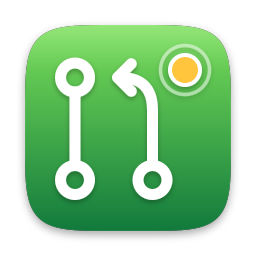
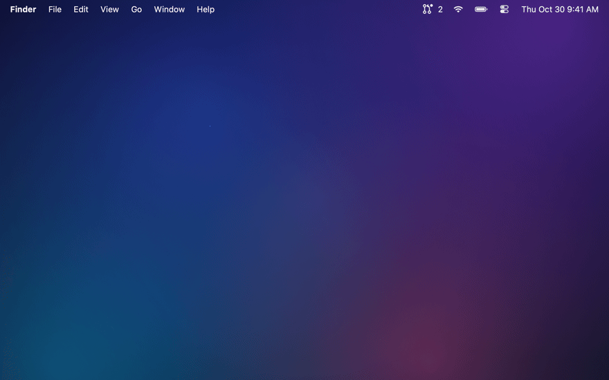
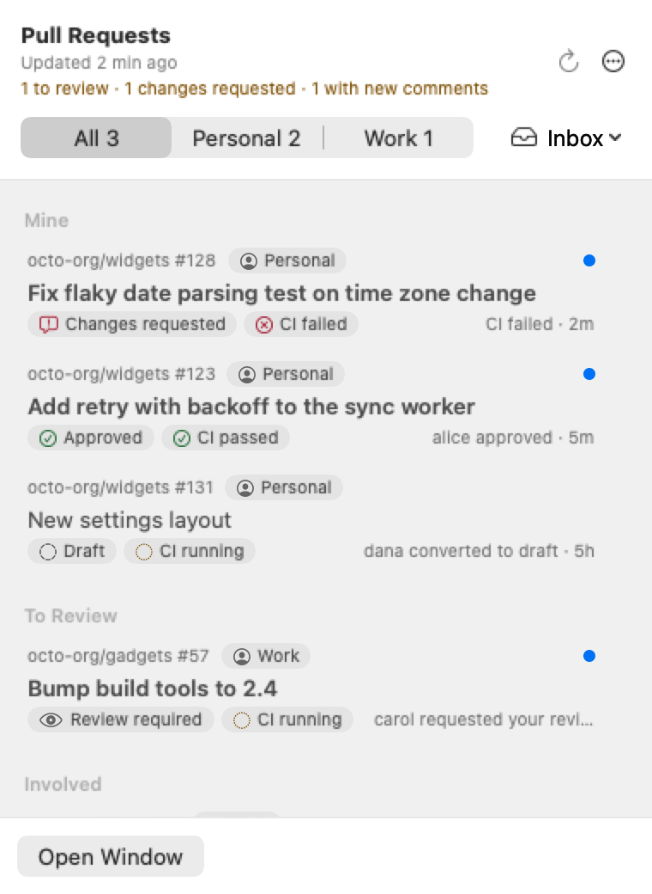
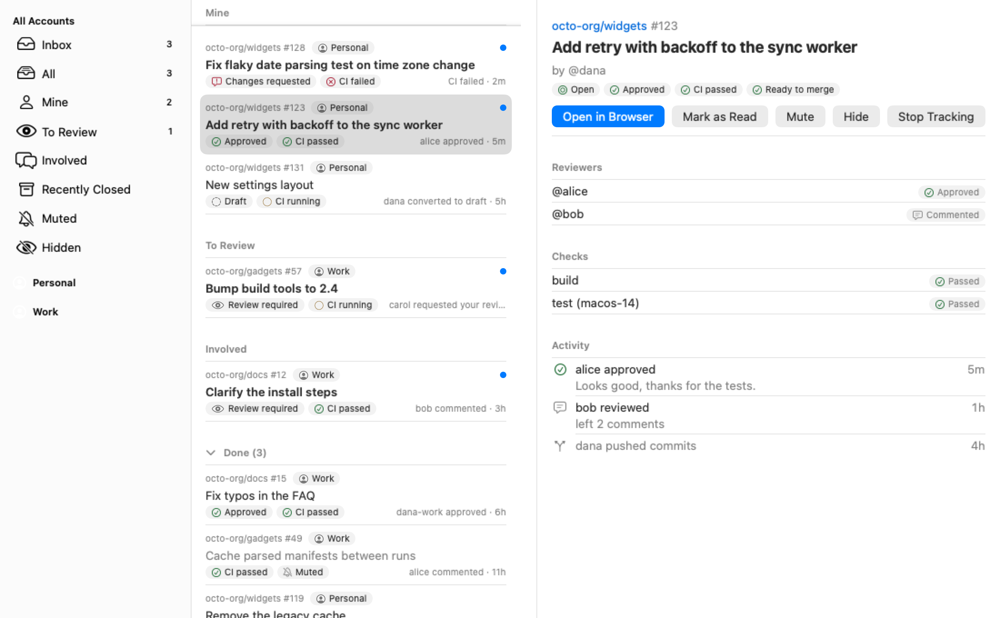
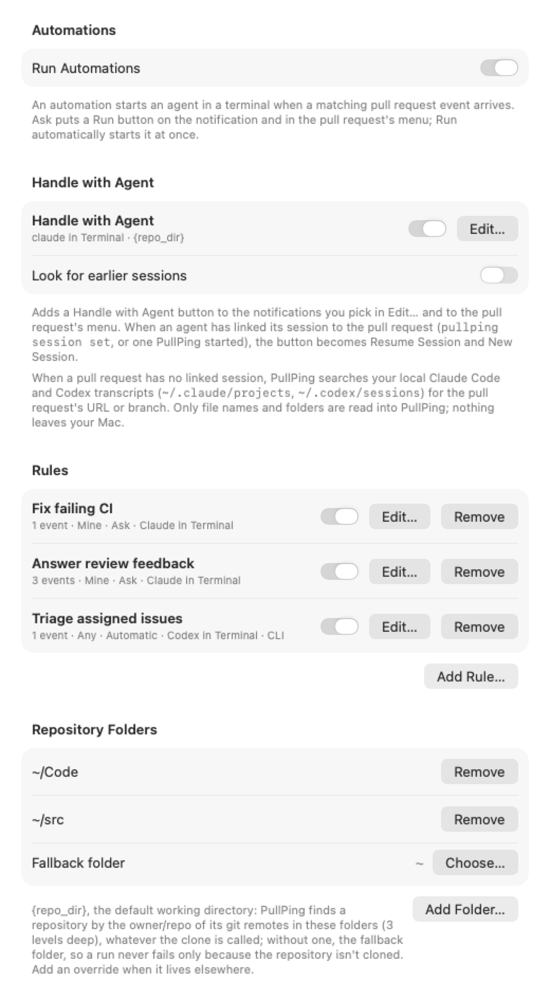
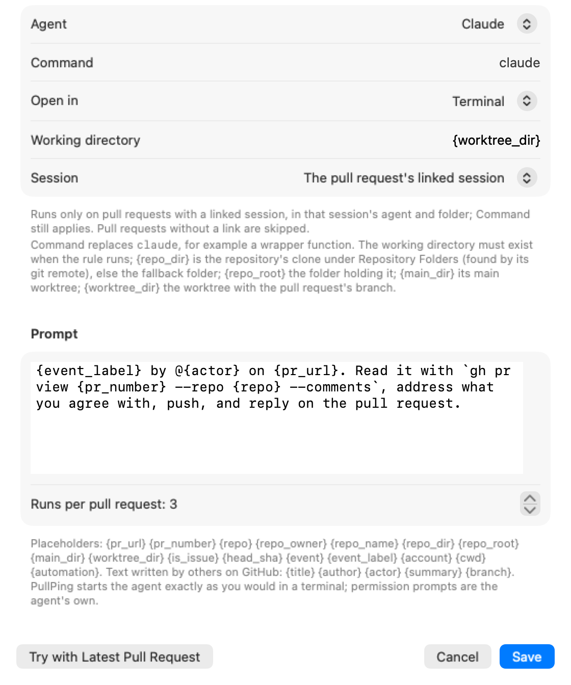
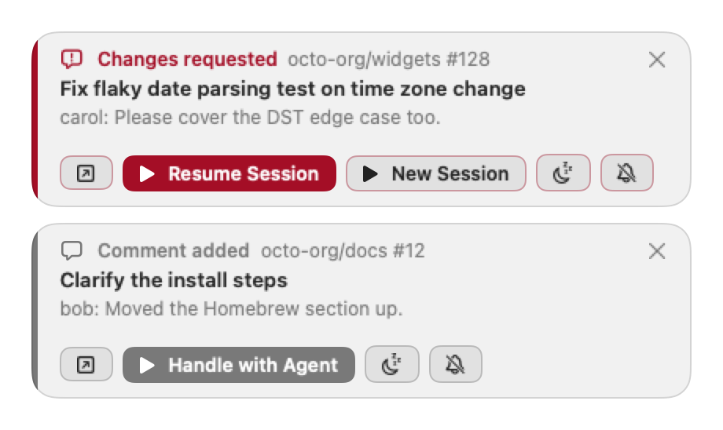

<div align="center">



# PullPing

### Know when your pull requests need you.

A small **macOS** menu-bar app that tracks every GitHub pull request (and issue) you are involved in,
across several accounts, and tells you when something happens: a review, a comment, a failing
check, a request for your review.

[](https://www.apple.com/macos/)
[](https://swift.org)
[](#requirements)
[](https://github.com/roypadina/PullPing/releases/latest)
[](https://github.com/roypadina/homebrew-tap)
[](https://github.com/roypadina/PullPing/actions/workflows/ci.yml)
[](https://apps.roypadina.synology.me/apps/pullping/)
[](LICENSE)
[](https://ko-fi.com/roypadina)
[](CONTRIBUTING.md)



<br>

```bash
brew install --cask roypadina/tap/pullping
```

<picture>
<source media="(prefers-color-scheme: dark)" srcset="docs/screenshots/status-panel-dark.png">

</picture>
&nbsp;


</div>

---

## Features

- **Every pull request you are involved in, in one place.** Ones you opened, ones assigned to you, ones where your review is requested (directly or through a team), and ones where you commented, reviewed or were mentioned. Merged and closed ones stay listed for a few days.
- **Issues too.** Open issues you opened, are assigned to, are mentioned in or commented on appear in the same lists with an **Issue** chip. Comments, mentions, assignments, label changes, renames, reopening and closing (shown as completed or not planned) notify like pull request events. Label changes on pull requests notify too. Settings → General → Track Issues turns issues off.
- **Several GitHub accounts at once.** Personal and work, each with its own token and a label you choose.
- **Menu-bar panel.** Your pull requests in three groups (Mine, To Review, Involved), with CI status, review state, an unread dot and the latest activity on each row. What needs you comes first, then unread, then the most recently active; pull requests with nothing left for you (merged, closed, or read with no review asked of you) wait in a collapsed Done group at the bottom. Switch between All accounts and each account, and filter (Inbox, All, Mine, To Review, Involved, Recently Closed, Muted, Hidden). Right-click the icon for Refresh, Mark All as Read, Pause Notifications, Settings and Quit.
- **A count that means something.** By default the menu-bar number counts only pull requests that need you: review requests, unread assignments and mentions, your own pull requests with changes requested, failed CI, new comments, or ready to merge, and new comments on issues you opened or are assigned to. The panel header spells it out ("2 to review · 1 ready to merge"). Settings → General → Count in the Menu Bar picks which of these count (team review requests have their own switch), or count everything unread, or show no number.
- **Main window.** Mail-style sidebar: the same filters for All Accounts and for each account, with counts, then the same order with a collapsible Done section at the bottom of the list, search and a detail view with reviewers, checks and the recent activity of the selected pull request. Prefer one inbox per account? Settings → General → Inbox → Per account.
- **Phone notifications** through [ntfy](https://ntfy.sh), chosen per kind of event, separately from the desktop panels.
- **Agent automations.** Start Claude Code or Codex in a terminal when a pull request event arrives: rules you write in Settings, or hooks an agent attaches from the command line ("resume this session when the pull request is approved"). Asks first by default.
- **Notifications that stay out of your way.** A small panel appears at the top right, never takes keyboard focus, and is grouped per pull request. Pick Off, Banner (hides itself) or Alert (stays) for each kind of event.
- **Review reminders.** While your review is requested, PullPing nudges you again every so often until you review, the request is removed, or the pull request is merged or closed.
- **Snooze, mute, hide, mark as read, stop tracking.** All of them from the panel, the menu bar and the main window, with Undo for Hide and Stop Tracking. Hidden pull requests leave every list and count but still notify you.
- **Keyboard friendly.** Arrow keys and Return in the panel, menu commands with shortcuts, VoiceOver announcements for new notifications.
- **`pullping://` links** for Shortcuts and Raycast.
- Universal binary, no third-party dependencies, no analytics.

## Requirements

macOS 14 Sonoma or later · Apple Silicon and Intel (universal binary)

## Install

### Homebrew

```bash
brew install --cask roypadina/tap/pullping
```

### First launch

PullPing is signed with a self-made certificate, not notarized. If macOS blocks it, open
**System Settings → Privacy & Security**, scroll down and click **Open Anyway** next to
PullPing. Or clear quarantine once:

```bash
xattr -dr com.apple.quarantine /Applications/PullPing.app
```

A **Welcome** window then explains where PullPing lives and offers to open it at login (you can change it later in
Settings → General); PullPing never adds itself silently. **Settings → General → About → Welcome Guide…** opens it again.

### Build from source

```bash
git clone https://github.com/roypadina/PullPing.git
cd PullPing
./build.sh
open dist/PullPing.app
```

`build.sh` runs `swift build` for Apple Silicon and Intel and assembles and signs
`dist/PullPing.app`. It is a plain Swift Package, no Xcode project. `swift test` runs the tests.

## Usage

1. Open PullPing. It lives in the menu bar and has no Dock icon.
2. Add an account: **Add Account…** in the Welcome window, or **Settings → Accounts**. See
   [Accounts and tokens](#accounts-and-tokens).
3. Click the menu-bar icon. **↩** opens the selected pull request in your browser, **⌘↩** opens it in the
   main window, **Esc** closes the panel. Right-click a row for Open in Browser, Mark as Read,
   Mute, Hide, Snooze and Stop Tracking. Right-click the menu-bar icon, or click **⋯** in the panel, for the same menu (Pause Notifications included).
4. The first sync of an account is silent: PullPing learns what already exists, and only tells
   you about what happens afterwards (plus review requests, assignments and mentions it finds).

Which pull requests are tracked: open pull requests that you opened, that are assigned to you,
that request your review (directly or through a team), or that you commented on, reviewed or
were mentioned in. Merged and closed ones stay for 1, 3 (default), 7 or 14 days, so a late comment
still reaches you.

| Command | Shortcut |
|---|---|
| Refresh now | ⌘R |
| Open the main window | ⌘1 |
| Open in browser | ⇧⌘O |
| Mark as read / Mark all as read | ⇧⌘U / ⌥⇧⌘U |
| Stop tracking | ⌘⌫ |
| Settings | ⌘, |

Links: `pullping://open`, `pullping://open?pr=<id>`, `pullping://refresh`, `pullping://settings`.

## Accounts and tokens

Add a personal access token in **Settings → Accounts → Add Account…**. PullPing checks it
(**Verify**) and shows who it belongs to before you add it. Add as many accounts as you like,
one token each.

- **Classic token:** scopes `repo` (private repositories) and `read:org` (team review requests). Public repositories only: `public_repo`. Organizations with SAML SSO: click "Configure SSO" on the token and authorize each organization.
- **Fine-grained token:** Resource owner = your user or the organization (one token per organization); Repository access = All repositories (or select); Permissions: Pull requests: Read, Issues: Read, Commit statuses: Read, Checks: Read (Metadata: Read is implied). Organizations may require admin approval; until approved the token sees only public data. CI status may be incomplete with fine-grained tokens (GitHub lists the Checks API as a gap); use a classic token when CI matters.

If a classic token lacks `repo` and `public_repo`, PullPing still adds the account and shows
"Missing repo scope" next to it.

**Sign in with GitHub** (OAuth device flow) is the other option in Add Account. You copy a short
code, approve it on github.com, and PullPing gets a token (scopes `repo` and `read:org`) without you
creating one. Organizations that restrict OAuth apps block this token until an
owner approves PullPing. Use a personal access token if a repository stays invisible.

## Notifications

When something happens on a pull request you are tracking, PullPing shows a small panel at the
top right of the screen your mouse is on. It never takes keyboard focus, so typing in another
app is never interrupted.

- **Styles, per kind of event:** Off, Banner (hides after 5, 8, 12 or 20 seconds; hovering pauses it) or Alert (stays until you act). Set separately for your own pull requests and for the ones you review or follow, in **Settings → Notifications**.
- **Defaults:** on your own pull requests every event shows a banner, and changes requested, CI failed and merged show an alert. On other pull requests, review requests, assignments and mentions show an alert; comments, reviews, merged and closed show a banner; the rest stay off.
- **One panel per pull request.** Several events on the same pull request merge into one panel; up to four panels are shown, the rest collapse into "+N more".
- **On each panel:** **Open** (opens the pull request and marks it read), **Snooze** (15 minutes, 1 hour, 3 hours, tomorrow 9:00), **Mute PR** (**Mute Issue** on an issue), and a close button.
- **Review reminders:** while your review is requested on an open, non-draft pull request, the "Review requested" panel shows again every 15, 30, 60 (default), 120 or 240 minutes, or never. It stops when you review, the request is removed, the pull request is merged or closed, or you mute or snooze it.
- **Mute** keeps a pull request listed but silences its panels and reminders and leaves it out of the menu-bar count. **Snooze** silences them for a while. **Stop Tracking** removes the pull request and ignores it from then on (Edit → Undo brings it back).
- **Pause:** right-click the menu-bar icon → **Pause Notifications** for 1 hour, 3 hours or until tomorrow 9:00. Panels, phone notifications and reminders stay quiet until then.
- **Phone (ntfy):** in **Settings → Phone**, enter a server (default `https://ntfy.sh`) and a topic, subscribe to the same topic in the ntfy phone app, then tick the kinds of event to send, for your own pull requests and for others. Nothing is sent until you tick one. Sends follow the same rules as panels (never your own actions, never muted, snoozed or paused pull requests) but ignore the desktop style, so a kind can go to the phone only. An optional access token (for a protected server) and a fallback topic URL (used when the server fails) are kept in your login keychain. **Send Test Notification** checks the setup.
- Your own actions never notify you. An optional sound plays once when panels appear. Every action on a panel also exists in the menu-bar panel and the menus, for keyboard and VoiceOver use.

## Agent automations

PullPing can start a local coding agent ([Claude Code](https://docs.anthropic.com/en/docs/claude-code) or
[Codex](https://github.com/openai/codex)) in a terminal when a pull request event arrives. It writes the prompt to a
file and a small script, opens a terminal that runs it, and stops there: it never talks to the agent, never reads its
output and never adds a permission flag.

- **Rules**, in **Settings → Automations → Add Rule…**: the kinds of event (comment, CI failed, review approved, …),
  which pull requests (Any, Mine, Others, optionally only some repositories `owner/name` or `owner/*` and only events
  by some logins), a prompt, a working directory (default `{repo_dir}`, below), the agent and where it opens (Terminal,
  iTerm2, Ghostty or Ghostex, whichever are installed, or your own command line). A rule runs at most 3 times per pull
  request unless you change it (1 to 10).
  **Try with Latest Pull Request** runs it right away so you can check the prompt.
- **Agent hooks**, added from the command line for one pull request or issue, usually by the agent that opened it:
  "resume this session when the pull request is approved or commented on". A hook runs once and is then removed;
  an unused one expires after 14 days.


&nbsp;


**Ask or run.** An automation asks by default: the notification gets a **Run …** button (and stays until you act),
and the pull request's right-click menu and the main window's toolbar get **Run Automation**. **Run automatically**
starts it at once. **Settings → Automations → Run Automations** (or `pullping automations off`) turns everything off;
**Recent Runs** there shows what started and what failed.

**Handle with Agent.** Turn it on in **Settings → Automations → Handle with Agent** (or `pullping handler on`) and the
notifications you pick get a **Handle with Agent** button, and the pull request's menu the same item: one click starts
your agent on that pull request or issue with a prompt you can edit (by default: read it with `gh`, work out what it
needs, do it, ask when unsure). **Edit…** picks those notifications (`pullping handler set --on <kind,…|all>`; by
default all but CI passed, new commits, merged, closed, draft, title and label changes), the agent, an optional wrapper
command, where it opens and the working directory (`{repo_dir}`). When the pull request has a linked session (below),
the button becomes **Resume Session** and **New Session**. It never runs on its own and has no run limit; a second click
while the terminal opens does nothing.



**Repositories.** `{repo_dir}`, the default working directory, is where the repository is checked out. PullPing looks in
**Settings → Automations → Repository Folders** (default `~/Code`; add `~/Code/Work`, `~/src`, …), up to 3 levels deep
(`~/Code/<repo>`, `~/Code/<org>/<repo>`, `~/src/github.com/<owner>/<repo>`), for a clone whose git remote is the
repository's `owner/repo`, whatever the folder is called and whichever host or SSH alias the remote uses (main worktrees
first, folders in list order). Then it tries a folder named like the repository; without one it is the fallback folder
(default `~`), so a run never fails only because the repository isn't cloned there (the prompt has `{pr_url}`, so the
agent can clone it). The pull request's linked session's folder wins when it is inside a clone of the repository, and an
override in **Repository Overrides** (`pullping automations repos set <owner/repo> <dir>`) wins over everything.
`{worktree_dir}` is the worktree that has the pull request's branch checked out, else the main one; `{repo_root}` is the
repository folder that holds the clone. PullPing reads git's own files to find them and never creates worktrees.
`pullping automations folders list` shows how many clones it found; `folders add|rm <dir>` and `fallback <dir>` change
the list.

**Where it opens.** Terminal and iTerm2 open the run's script file; Ghostty gets a new window through its AppleScript
dictionary (macOS asks once to let PullPing control Ghostty); Ghostex through `ghostex terminal`. Only installed apps are
offered; a rule whose app is gone shows "(not installed)" and its runs fail with that message. For any other terminal
(WezTerm, kitty, Alacritty, cmux, …) choose **Custom command** and write the launch line with `{script}`, `{cwd}` and
`{title}`; `pullping launchers` lists the built-in ones.

### Linked sessions

A linked session is the agent session that last touched a pull request or issue: Resume Session opens it again with
the new event as the next message. An agent links itself from inside its session whenever it creates, reviews or
touches a pull request:

```bash
pullping session set --pr <url> --session "$CLAUDE_CODE_SESSION_ID" --agent claude --quiet
```

`hook add --session <id>` links too, and every new Claude Code session PullPing starts on a pull request is linked
automatically (it starts with an id PullPing picks, `claude --session-id`). One link per pull request; the last writer
wins. Claude Code resumes a session only from the folder it was started in, so the link stores that folder, read from
the session's transcript (`~/.claude/projects`, or `$CLAUDE_CONFIG_DIR`), not the agent's current directory; `--cwd`
overrides it. Codex resumes by id (`--agent codex --session <thread id>`). A rule can resume the linked session too:
choose **The pull request's linked session** in its editor (`--session linked`); it then runs only on pull requests
with a link. Links show in **Settings → Automations → Linked Sessions** and in the main window's detail
(`pullping session list|show|rm`), and are dropped an hour after the pull request is merged or closed, a day after it
stops being tracked, and 30 days after they were set.

If the session's folder is gone, Resume Session starts in `{worktree_dir}` (else the main worktree, the repository, the
fallback folder) and says so in Recent Runs: Claude Code 2.1.223 and later and Codex resume a session by id from any
folder. On an older Claude Code the run fails with "The session's folder is gone". A session whose transcript was
deleted (Claude Code removes them after `cleanupPeriodDays`, 30 days by default) fails with "The session's transcript is
gone", and the panel keeps **New Session**.

### Earlier sessions

When a pull request has no linked session, PullPing can look for the local session that worked on it: turn on **Look
for earlier sessions** under Handle with Agent (`pullping handler set --find-sessions on`; off by default, since it reads
your agent history). It searches your Claude Code transcripts (`~/.claude/projects`, and `$CLAUDE_CONFIG_DIR` when
PullPing has it) and Codex sessions (`~/.codex/sessions`), newest first, for the record Claude Code writes when a session
creates the pull request, then for its URL or `owner/repo#12`, then for a session launched on its branch that names the
repository. It reads at most the last 60 days, 1.5 GB or 10 seconds, only into memory; nothing is
written and nothing leaves your Mac. A found session turns the notification's Handle with Agent into **Resume Earlier**
and **New Session**, and the menu gets **Resume Earlier Session** (its title and folder in the tooltip); **Find Earlier
Session…** in the menu searches now, whatever the setting. Resuming links it (source `found`).

Agents do the same from the shell. The default prompts tell a new session with no earlier context to run

```bash
pullping session find --pr <url> --link     # prints up to 3 sessions and their transcript paths; links the best one
pullping session resume --pr <url>          # Resume Session from the shell, then stop
```

`session find` runs whatever the setting says and links only a session that created the pull request or worked on its
branch (one that merely mentions it is printed, not linked). `session resume` has the button's gates and one more pair:
it refuses a session whose transcript changed in the last 2 minutes (probably open in another terminal; `--force`
starts it anyway), the calling session itself (even with `--force`) and a second hand-off on the same pull request
within a minute. Recent Runs shows who handed off (`--by`, default the calling session).

### From the command line

The `pullping` command is the app itself. Homebrew puts it on your PATH; from source, link it (Settings → Automations
shows this line with a Copy button):

```bash
ln -s /Applications/PullPing.app/Contents/MacOS/PullPing /usr/local/bin/pullping
```

A rule, the same as one written in Settings:

```bash
pullping rule add --name "Fix failing CI" --on ciFailed --scope mine --repos octo-org/\*
```

A rule that resumes the pull request's linked session when someone comments:

```bash
pullping rule add --name "Answer comments" --on comment --scope mine --session linked \
  --prompt "New activity on {pr_url}: {event_label} by @{actor}. Read it with gh and act on it."
```

A hook, from inside a Claude Code session right after it opens a pull request:

```bash
pullping hook add --pr "$(gh pr view --json url -q .url)" --on reviewApproved,reviewChangesRequested,comment \
  --session "$CLAUDE_CODE_SESSION_ID" --prompt "Review what changed on {pr_url} since my last turn and act on it."
```

Everything the Automations tab does has a command: `pullping rule|hook add|edit|show|list|enable|disable|rm`,
`pullping session set|show|list|rm|find|resume` (linked and earlier sessions), `pullping handler show|set|on|off` (Handle with Agent),
`pullping run <id> --pr <ref>` (Run Automation; `--dry-run` only prints what it would start), `pullping runs` (Recent
Runs), `pullping automations on|off|status`, `pullping automations folders|fallback|repos` (Repository Folders),
`pullping kinds` (the event names) and `pullping launchers` (where it can open). Every reader takes `--json` and
prints what `automations.json` stores, so an agent can read an automation and write it back with flags.
`pullping --help`, `pullping rule --help` and `pullping hook --help` list every option (Codex: `--agent codex --session
<thread id>`; `--auto` starts without asking). It works while PullPing is not running: the app picks changes up within
30 seconds. Automations written from the command line are marked **CLI** in Settings, and the first time one is set to
run automatically PullPing tells you.
A Claude Code skill with these recipes is in [`docs/claude-skill/pullping`](docs/claude-skill/pullping/SKILL.md);
link that folder into `~/.claude/skills/`.

### Prompt placeholders

| Placeholder | Value |
|---|---|
| `{pr_url}`, `{pr_number}` | The pull request or issue |
| `{repo}`, `{repo_owner}`, `{repo_name}` | `owner/name` and its two halves |
| `{repo_dir}` | Where the repository is checked out (Repositories, above), else the fallback folder |
| `{repo_root}` | The repository folder that holds it (`~/Code/Work`); the fallback folder when there is none |
| `{main_dir}` | The clone's main worktree |
| `{worktree_dir}` | The worktree with the pull request's branch checked out, else `{main_dir}` |
| `{is_issue}` | `true` or `false` |
| `{head_sha}` | The head commit |
| `{event}`, `{event_label}` | `reviewApproved`, `Review approved`; `manual`, `Manual run` from the menu |
| `{account}` | Your login on that account |
| `{session_id}` | The session being resumed, or empty |
| `{cwd}` | The working directory |
| `{automation}` | The rule or hook name |
| `{title}`, `{author}`, `{actor}`, `{summary}`, `{branch}` | Written by others on GitHub: control characters removed and shortened (`{summary}` is the first line of a comment, at most 120 characters; `{branch}` is the pull request's head branch, empty for an issue) |

The working directory takes the same placeholders, except the five written by others, and `~`. Unknown `{…}` stays as
typed. A prompt that starts with a placeholder or a `-` gets a blank first line, so the agent never reads it as an option.

### Safety

An automation lets an event on GitHub start a process on your Mac, so PullPing keeps that edge narrow:

- **No text from GitHub in a shell command.** The prompt goes to a file the agent reads as its first message. Every
  value in the script and the launch line is quoted; repository names, numbers and session ids are checked first, and
  the working directory must exist. The only argument PullPing adds is `--session-id` with a UUID it generated itself.
- **No comment bodies.** Only the placeholders above reach the prompt; the default prompt leaves out `{summary}` and
  tells the agent to treat quoted GitHub text as input, not instructions. The agent reads the pull request itself
  with `gh`, as it would if you asked it to.
- **No permission bypass.** PullPing starts the agent exactly as you would in a terminal: never with
  `--dangerously-skip-permissions`, `--full-auto` or a similar flag. Permission prompts are the agent's own. Shell
  aliases are skipped (`\claude`, `\codex`), so an alias that adds such a flag does not apply; functions and the
  Command field still do, and are yours to keep safe.
- **A fresh session.** Opened from a terminal agent, PullPing inherits that agent's session variables; it drops every
  `CLAUDE*` and `CODEX_*` variable (and those of a few session-switching tools) before a launch, so the agent it starts never
  takes over the other one's session. Your shell profile still sets anything you export there.
- **No loops.** Your own comments and reviews never trigger anything, nor do pushes whose head commit GitHub links to
  your account (your own merge, close, reopen or draft change can, so "when I merge it" works). A commit made under
  another git identity, or cherry-picked, looks like someone else's push, so once an automation has started an agent on
  a pull request, new commits there only offer it again. An automation never runs twice for the same event, never
  automatically again on the same pull request within 10 minutes or after 3 failed starts there, at most its number of
  successful runs per pull request, and at most 3 automatic starts per check; the rest wait for a Run click.
- **Agents' automations show.** Automations written by agents are marked CLI in Settings, and the first time one is
  set to run automatically PullPing tells you.
- **The usual switches apply.** Pause, mute, snooze, hide and turning an account off stop automations too. An automatic
  rule with no logins in "Only from" runs for anyone who can comment on the repository; add logins to narrow it.

Rules, hooks, Handle with Agent and linked sessions (session ids and their folders) live in
`~/Library/Application Support/PullPing/automations.json`; each run's prompt and script go in
`runs/` beside it, readable only by you, and are deleted after 7 days.

## Permissions

None. PullPing asks macOS for no permission: no Accessibility, no notification
authorization (the panels are PullPing's own), no Full Disk Access. Tokens are stored in your login keychain
through macOS's `security` tool, which does not prompt either. Launch at login is optional, and
only through the toggle you turn on yourself.

## Limitations

- **Polling, not push.** PullPing asks GitHub every 1 to 15 minutes (3 by default), so an event can arrive up to one interval late. Refresh now (⌘R) checks immediately, at most once every 10 seconds. It also checks after wake and when the network comes back.
- **Focus and Do Not Disturb are not detected.** macOS offers no API for it, so panels appear even during a Focus. Turn off notifications in Settings → Notifications to silence PullPing.
- **Fine-grained tokens and CI.** CI status may be incomplete with fine-grained tokens; use a classic token when CI matters.
- **Sign in with GitHub** tokens can be blocked by organizations that restrict OAuth apps until an owner approves PullPing. Personal access tokens always work.
- **GitHub.com only.** GitHub Enterprise Server is not supported yet.
- **Rate limit.** GitHub gives each token a budget of 5,000 API points per hour; PullPing uses a small fraction. When a token runs low it pauses refreshing until the limit resets and shows "Rate limited" on the account.
- **Not notarized.** See [First launch](#first-launch).

## Privacy

- **Tokens** live in your login keychain, one item per account (`com.padina.pullping.token.<id>`), plus `com.padina.pullping.token.<id>.refresh` for a Sign in with GitHub refresh token. They are sent only to GitHub and never written to a file or a log. The optional ntfy access token and fallback topic URL live there too (`com.padina.pullping.ntfy-token`, `com.padina.pullping.ntfy-fallback`).
- **Your data stays on your Mac** in `~/Library/Application Support/PullPing` (pull request titles, activity and your mute and snooze choices) and in the app's preferences.
- **Only `api.github.com`, `github.com` and `avatars.githubusercontent.com` are contacted** (`github.com` only for Sign in with GitHub; the avatars host for account pictures), plus your ntfy server once you set up phone notifications: it receives the title, repository and latest activity of the pull requests you chose to send, and a footer line naming the sender as `pullping@<your Mac's short hostname>`.
- **No analytics, no telemetry, no crash reporting, no accounts on any other service.**

## Uninstall

1. Remove your accounts in **Settings → Accounts → Remove…** (this deletes each token from the keychain), then quit PullPing.
2. Homebrew: `brew uninstall --cask pullping`. Otherwise delete `/Applications/PullPing.app`.
3. Delete its data: `~/Library/Application Support/PullPing` and `~/Library/Preferences/com.padina.pullping.plist`, and `/usr/local/bin/pullping` if you linked it.
4. If you skipped step 1, list and delete the leftover keychain items:

   ```bash
   security dump-keychain login.keychain-db | grep -o 'com.padina.pullping.token[.A-Za-z0-9-]*' | sort -u
   security delete-generic-password -s com.padina.pullping.token.<id>
   ```

5. If you enabled launch at login, it is removed with the app; check
   **System Settings → General → Login Items & Extensions**.

## Feature requests and contributions

Have an idea for PullPing? [Request a feature](https://github.com/roypadina/PullPing/issues/new?template=feature_request.yml) and say what you're trying to do; that matters more than the exact feature. Found a bug? [Report it](https://github.com/roypadina/PullPing/issues/new?template=bug_report.yml).

Code is welcome too: small, focused pull requests, and an issue first for anything bigger. See [CONTRIBUTING.md](CONTRIBUTING.md).

Tipped on [Ko-fi](https://ko-fi.com/roypadina)? Add your Ko-fi name to the request and it goes to the front of my queue. It's a thank-you, not a purchase: no promise on what ships or when.

## More Mac apps by Roy

Free, open-source Mac menu-bar apps and terminal tools, all on one site: **[apps.roypadina.synology.me](https://apps.roypadina.synology.me/)**.

- [MeetAlert](https://apps.roypadina.synology.me/apps/meetalert/) — Meeting alerts you can't miss: a popup that stays, a phone push that escalates.
- [NtfyBar](https://apps.roypadina.synology.me/apps/ntfybar/) — ntfy notifications on your Mac: popups that stay, rules, commands, plugins.
- [Window Organizer](https://apps.roypadina.synology.me/apps/window-organizer/) — Clear the desk in one keystroke.
- [Agents Monitor](https://apps.roypadina.synology.me/apps/agents-monitor/) — See your Claude Code and Codex usage limits before you hit them.

## Support

If PullPing saves you from a forgotten review, you can support its development. It's optional and always appreciated.

[](https://ko-fi.com/roypadina)

A ⭐ on the repo helps just as much.

## License

[MIT](LICENSE) © 2026 Roy Padina
