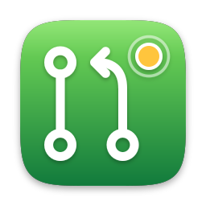
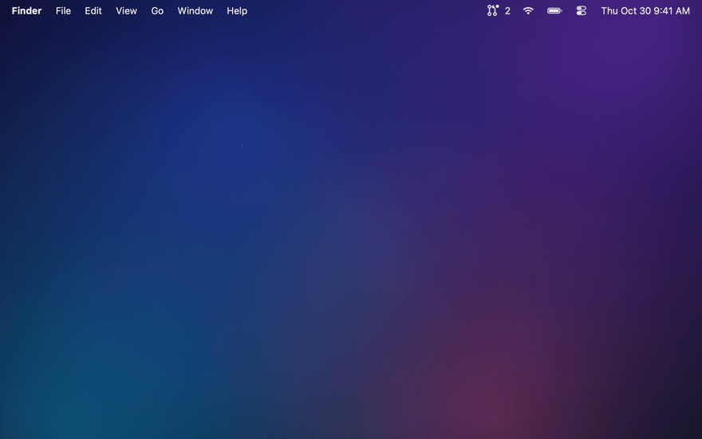
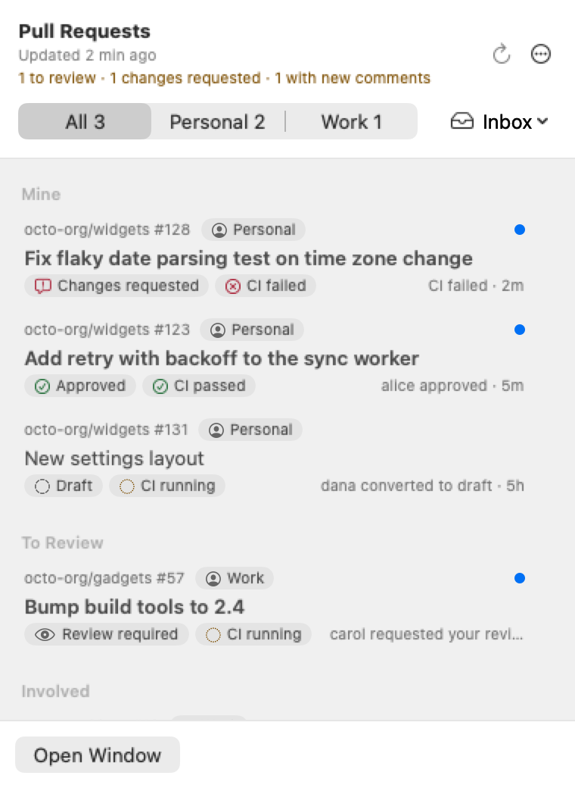
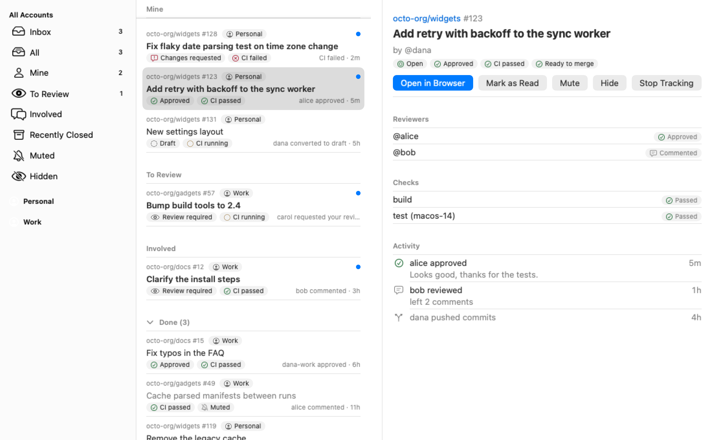

<div align="center">



# PullPing

### Know when your pull requests need you.

A small **macOS** menu-bar app that tracks every GitHub pull request (and issue) you are involved in,
across several accounts, and tells you when something happens: a review, a comment, a failing
check, a request for your review.

[](https://www.apple.com/macos/)
[](https://swift.org)
[](#requirements)
[](https://github.com/roypadina/PullPing/releases/latest)
[](https://github.com/roypadina/homebrew-tap)
[](https://github.com/roypadina/PullPing/actions/workflows/ci.yml)
[](https://apps.roypadina.synology.me/apps/pullping/)
[](LICENSE)
[](https://ko-fi.com/roypadina)
[](CONTRIBUTING.md)



<br>

```bash
brew install --cask roypadina/tap/pullping
```

<picture>
<source media="(prefers-color-scheme: dark)" srcset="docs/screenshots/status-panel-dark.png">

</picture>
&nbsp;


</div>

---

## Features

- **Every pull request you are involved in, in one place.** Ones you opened, ones assigned to you, ones where your review is requested (directly or through a team), and ones where you commented, reviewed or were mentioned. Merged and closed ones stay listed for a few days.
- **Issues too.** Open issues you opened, are assigned to, are mentioned in or commented on appear in the same lists with an **Issue** chip. Comments, mentions, assignments, label changes, renames, reopening and closing (shown as completed or not planned) notify like pull request events. Label changes on pull requests notify too. Settings → General → Track Issues turns issues off.
- **Several GitHub accounts at once.** Personal and work, each with its own token and a label you choose.
- **Menu-bar panel.** Your pull requests in three groups (Mine, To Review, Involved), with CI status, review state, an unread dot and the latest activity on each row. What needs you comes first, then unread, then the most recently active; pull requests with nothing left for you (merged, closed, or read with no review asked of you) wait in a collapsed Done group at the bottom. Switch between All accounts and each account, and filter (Inbox, All, Mine, To Review, Involved, Recently Closed, Muted, Hidden). Right-click the icon for Refresh, Mark All as Read, Pause Notifications, Settings and Quit.
- **A count that means something.** By default the menu-bar number counts only pull requests that need you: review requests, unread assignments and mentions, your own pull requests with changes requested, failed CI, new comments, or ready to merge, and new comments on issues you opened or are assigned to. The panel header spells it out ("2 to review · 1 ready to merge"). Settings → General → Count in the Menu Bar picks which of these count (team review requests have their own switch), or count everything unread, or show no number.
- **Main window.** Mail-style sidebar: the same filters for All Accounts and for each account, with counts, then the same order with a collapsible Done section at the bottom of the list, search and a detail view with reviewers, checks and the recent activity of the selected pull request. Prefer one inbox per account? Settings → General → Inbox → Per account.
- **Phone notifications** through [ntfy](https://ntfy.sh), chosen per kind of event, separately from the desktop panels.
- **Notifications that stay out of your way.** A small panel appears at the top right, never takes keyboard focus, and is grouped per pull request. Pick Off, Banner (hides itself) or Alert (stays) for each kind of event.
- **Review reminders.** While your review is requested, PullPing nudges you again every so often until you review, the request is removed, or the pull request is merged or closed.
- **Snooze, mute, hide, mark as read, stop tracking.** All of them from the panel, the menu bar and the main window, with Undo for Hide and Stop Tracking. Hidden pull requests leave every list and count but still notify you.
- **Keyboard friendly.** Arrow keys and Return in the panel, menu commands with shortcuts, VoiceOver announcements for new notifications.
- **`pullping://` links** for Shortcuts and Raycast.
- Universal binary, no third-party dependencies, no analytics.

## Requirements

macOS 14 Sonoma or later · Apple Silicon and Intel (universal binary)

## Install

### Homebrew

```bash
brew install --cask roypadina/tap/pullping
```

### First launch

PullPing is signed with a self-made certificate, not notarized. If macOS blocks it, open
**System Settings → Privacy & Security**, scroll down and click **Open Anyway** next to
PullPing. Or clear quarantine once:

```bash
xattr -dr com.apple.quarantine /Applications/PullPing.app
```

A **Welcome** window then explains where PullPing lives and offers to open it at login (you can change it later in
Settings → General); PullPing never adds itself silently. **Settings → General → About → Welcome Guide…** opens it again.

### Build from source

```bash
git clone https://github.com/roypadina/PullPing.git
cd PullPing
./build.sh
open dist/PullPing.app
```

`build.sh` runs `swift build` for Apple Silicon and Intel and assembles and signs
`dist/PullPing.app`. It is a plain Swift Package, no Xcode project. `swift test` runs the tests.

## Usage

1. Open PullPing. It lives in the menu bar and has no Dock icon.
2. Add an account: **Add Account…** in the Welcome window, or **Settings → Accounts**. See
   [Accounts and tokens](#accounts-and-tokens).
3. Click the menu-bar icon. **↩** opens the selected pull request in your browser, **⌘↩** opens it in the
   main window, **Esc** closes the panel. Right-click a row for Open in Browser, Mark as Read,
   Mute, Hide, Snooze and Stop Tracking. Right-click the menu-bar icon, or click **⋯** in the panel, for the same menu (Pause Notifications included).
4. The first sync of an account is silent: PullPing learns what already exists, and only tells
   you about what happens afterwards (plus review requests, assignments and mentions it finds).

Which pull requests are tracked: open pull requests that you opened, that are assigned to you,
that request your review (directly or through a team), or that you commented on, reviewed or
were mentioned in. Merged and closed ones stay for 1, 3 (default), 7 or 14 days, so a late comment
still reaches you.

| Command | Shortcut |
|---|---|
| Refresh now | ⌘R |
| Open the main window | ⌘1 |
| Open in browser | ⇧⌘O |
| Mark as read / Mark all as read | ⇧⌘U / ⌥⇧⌘U |
| Stop tracking | ⌘⌫ |
| Settings | ⌘, |

Links: `pullping://open`, `pullping://open?pr=<id>`, `pullping://refresh`, `pullping://settings`.

## Accounts and tokens

Add a personal access token in **Settings → Accounts → Add Account…**. PullPing checks it
(**Verify**) and shows who it belongs to before you add it. Add as many accounts as you like,
one token each.

- **Classic token:** scopes `repo` (private repositories) and `read:org` (team review requests). Public repositories only: `public_repo`. Organizations with SAML SSO: click "Configure SSO" on the token and authorize each organization.
- **Fine-grained token:** Resource owner = your user or the organization (one token per organization); Repository access = All repositories (or select); Permissions: Pull requests: Read, Issues: Read, Commit statuses: Read, Checks: Read (Metadata: Read is implied). Organizations may require admin approval; until approved the token sees only public data. CI status may be incomplete with fine-grained tokens (GitHub lists the Checks API as a gap); use a classic token when CI matters.

If a classic token lacks `repo` and `public_repo`, PullPing still adds the account and shows
"Missing repo scope" next to it.

**Sign in with GitHub** (OAuth device flow) is the other option in Add Account. You copy a short
code, approve it on github.com, and PullPing gets a token (scopes `repo` and `read:org`) without you
creating one. Organizations that restrict OAuth apps block this token until an
owner approves PullPing. Use a personal access token if a repository stays invisible.

## Notifications

When something happens on a pull request you are tracking, PullPing shows a small panel at the
top right of the screen your mouse is on. It never takes keyboard focus, so typing in another
app is never interrupted.

- **Styles, per kind of event:** Off, Banner (hides after 5, 8, 12 or 20 seconds; hovering pauses it) or Alert (stays until you act). Set separately for your own pull requests and for the ones you review or follow, in **Settings → Notifications**.
- **Defaults:** on your own pull requests every event shows a banner, and changes requested, CI failed and merged show an alert. On other pull requests, review requests, assignments and mentions show an alert; comments, reviews, merged and closed show a banner; the rest stay off.
- **One panel per pull request.** Several events on the same pull request merge into one panel; up to four panels are shown, the rest collapse into "+N more".
- **On each panel:** **Open** (opens the pull request and marks it read), **Snooze** (15 minutes, 1 hour, 3 hours, tomorrow 9:00), **Mute PR** (**Mute Issue** on an issue), and a close button.
- **Review reminders:** while your review is requested on an open, non-draft pull request, the "Review requested" panel shows again every 15, 30, 60 (default), 120 or 240 minutes, or never. It stops when you review, the request is removed, the pull request is merged or closed, or you mute or snooze it.
- **Mute** keeps a pull request listed but silences its panels and reminders and leaves it out of the menu-bar count. **Snooze** silences them for a while. **Stop Tracking** removes the pull request and ignores it from then on (Edit → Undo brings it back).
- **Pause:** right-click the menu-bar icon → **Pause Notifications** for 1 hour, 3 hours or until tomorrow 9:00. Panels, phone notifications and reminders stay quiet until then.
- **Phone (ntfy):** in **Settings → Phone**, enter a server (default `https://ntfy.sh`) and a topic, subscribe to the same topic in the ntfy phone app, then tick the kinds of event to send, for your own pull requests and for others. Nothing is sent until you tick one. Sends follow the same rules as panels (never your own actions, never muted, snoozed or paused pull requests) but ignore the desktop style, so a kind can go to the phone only. An optional access token (for a protected server) and a fallback topic URL (used when the server fails) are kept in your login keychain. **Send Test Notification** checks the setup.
- Your own actions never notify you. An optional sound plays once when panels appear. Every action on a panel also exists in the menu-bar panel and the menus, for keyboard and VoiceOver use.

## Permissions

None. PullPing asks macOS for no permission: no Accessibility, no notification
authorization (the panels are PullPing's own), no Full Disk Access. Tokens are stored in your login keychain
through macOS's `security` tool, which does not prompt either. Launch at login is optional, and
only through the toggle you turn on yourself.

## Limitations

- **Polling, not push.** PullPing asks GitHub every 1 to 15 minutes (3 by default), so an event can arrive up to one interval late. Refresh now (⌘R) checks immediately, at most once every 10 seconds. It also checks after wake and when the network comes back.
- **Focus and Do Not Disturb are not detected.** macOS offers no API for it, so panels appear even during a Focus. Turn off notifications in Settings → Notifications to silence PullPing.
- **Fine-grained tokens and CI.** CI status may be incomplete with fine-grained tokens; use a classic token when CI matters.
- **Sign in with GitHub** tokens can be blocked by organizations that restrict OAuth apps until an owner approves PullPing. Personal access tokens always work.
- **GitHub.com only.** GitHub Enterprise Server is not supported yet.
- **Rate limit.** GitHub gives each token a budget of 5,000 API points per hour; PullPing uses a small fraction. When a token runs low it pauses refreshing until the limit resets and shows "Rate limited" on the account.
- **Not notarized.** See [First launch](#first-launch).

## Privacy

- **Tokens** live in your login keychain, one item per account (`com.padina.pullping.token.<id>`). They are sent only to GitHub and never written to a file or a log. The optional ntfy access token and fallback topic URL live there too (`com.padina.pullping.ntfy-token`, `com.padina.pullping.ntfy-fallback`).
- **Your data stays on your Mac** in `~/Library/Application Support/PullPing` (pull request titles, activity and your mute and snooze choices) and in the app's preferences.
- **Only `api.github.com`, `github.com` and `avatars.githubusercontent.com` are contacted** (`github.com` only for Sign in with GitHub; the avatars host for account pictures), plus your ntfy server once you set up phone notifications: it receives the title, repository and latest activity of the pull requests you chose to send, and a footer line naming the sender as `pullping@<your Mac's short hostname>`.
- **No analytics, no telemetry, no crash reporting, no accounts on any other service.**

## Uninstall

1. Remove your accounts in **Settings → Accounts → Remove…** (this deletes each token from the keychain), then quit PullPing.
2. Homebrew: `brew uninstall --cask pullping`. Otherwise delete `/Applications/PullPing.app`.
3. Delete its data: `~/Library/Application Support/PullPing` and `~/Library/Preferences/com.padina.pullping.plist`.
4. If you skipped step 1, list and delete the leftover keychain items:

   ```bash
   security dump-keychain login.keychain-db | grep -o 'com.padina.pullping.token[.A-Fa-f0-9-]*' | sort -u
   security delete-generic-password -s com.padina.pullping.token.<id>
   ```

5. If you enabled launch at login, it is removed with the app; check
   **System Settings → General → Login Items & Extensions**.

## Feature requests and contributions

Have an idea for PullPing? [Request a feature](https://github.com/roypadina/PullPing/issues/new?template=feature_request.yml) and say what you're trying to do; that matters more than the exact feature. Found a bug? [Report it](https://github.com/roypadina/PullPing/issues/new?template=bug_report.yml).

Code is welcome too: small, focused pull requests, and an issue first for anything bigger. See [CONTRIBUTING.md](CONTRIBUTING.md).

Tipped on [Ko-fi](https://ko-fi.com/roypadina)? Add your Ko-fi name to the request and it goes to the front of my queue. It's a thank-you, not a purchase: no promise on what ships or when.

## More Mac apps by Roy

Free, open-source Mac menu-bar apps and terminal tools, all on one site: **[apps.roypadina.synology.me](https://apps.roypadina.synology.me/)**.

- [MeetAlert](https://apps.roypadina.synology.me/apps/meetalert/) — Meeting alerts you can't miss: a popup that stays, a phone push that escalates.
- [NtfyBar](https://apps.roypadina.synology.me/apps/ntfybar/) — ntfy notifications on your Mac: popups that stay, rules, commands, plugins.
- [Window Organizer](https://apps.roypadina.synology.me/apps/window-organizer/) — Clear the desk in one keystroke.
- [Agents Monitor](https://apps.roypadina.synology.me/apps/agents-monitor/) — See your Claude Code and Codex usage limits before you hit them.

## Support

If PullPing saves you from a forgotten review, you can support its development. It's optional and always appreciated.

[](https://ko-fi.com/roypadina)

A ⭐ on the repo helps just as much.

## License

[MIT](LICENSE) © 2026 Roy Padina
